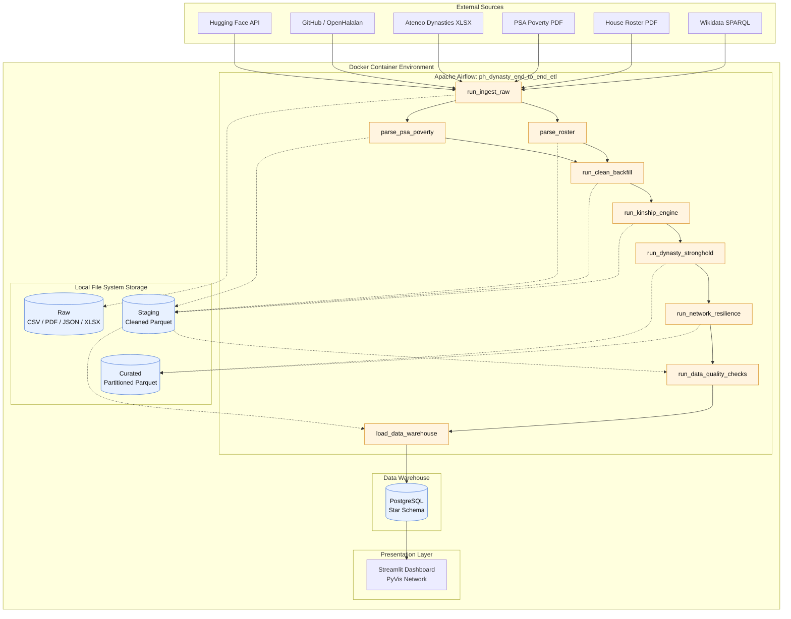
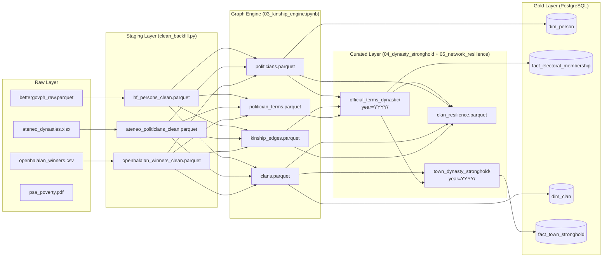

# Philippine Political Dynasty Analytics & Network Resilience Pipeline

An end-to-end, containerized Data Engineering pipeline that ingests, cleans, models, and analyzes multi-decade Philippine election records and public official datasets.

The system maps familial ties (including multi-hop kinship such as siblings, 1st cousins, and maternal links) to calculate empirical town-level dynasty stronghold metrics and run network percolation/cascade simulations to test dynasty resilience under systemic political disruptions.

## Table of Contents

- [A. Project Context and Motivation](#a-project-context-and-motivation)
- [B. Tech Stack](#b-tech-stack)
- [C. End-to-End Architecture](#c-end-to-end-architecture)
- [D. Data Sources and Provenance](#d-data-sources-and-provenance)
- [E. Data Lineage and Transformation Flow](#e-data-lineage-and-transformation-flow)
- [F. Storage Format Benchmarking and Partitioning Strategy](#f-storage-format-benchmarking-and-partitioning-strategy)
- [G. Getting Started](#g-getting-started)
- [H. Verifying Outputs and Rerun Safety](#h-verifying-outputs-and-rerun-safety)
- [I. Troubleshooting](#i-troubleshooting)
- [J. Future Improvements](#j-future-improvements)

---

## A. Project Context and Motivation

| | |
| :--- | :--- |
| **Problem Statement** | The 1987 Philippine Constitution prohibits political dynasties, yet enabling legislation has never been passed. Quantifying the entrenchment and resilience of these political clans is computationally difficult due to highly fragmented, non-relational historical electoral records dispersed across multiple decades and file formats. |
| **Objectives** | Build a reproducible Medallion Architecture pipeline to extract and standardize historical records; programmatically resolve familial networks using graph theory; and simulate targeted disqualification cascades to identify network vulnerabilities. |
| **Stakeholders** | COMELEC, political science researchers, policy-makers, and election watchdogs (e.g., PCIJ, NAMFREL). |
| **Scope** | Electoral records from 1988 to 2025 covering local (Mayor, Vice Mayor, Councilor), provincial (Governor, Vice Governor, Board Member), and district-level (House of Representatives) positions. |
| **Limitations** | Data is left-censored (pre-1988 local data is mostly unavailable). Kinship mapping relies on naming conventions (shared surnames and maternal middle names) rather than official birth certificates. Fuzzy string matching for geographic joins limits some cross-dataset validation. |
| **Intended Data Product** | A fully orchestrated, idempotent ETL pipeline producing curated Parquet partitions and a PostgreSQL data warehouse, surfaced via an interactive Streamlit graph-analytics dashboard. |

## B. Tech Stack

| Layer | Technology |
| :--- | :--- |
| **Orchestration** | Apache Airflow |
| **Database & Modeling** | PostgreSQL (Star Schema + Kinship Graph Edges) |
| **Storage Layers** | Medallion Architecture (Raw > Staging > Curated Parquet) |
| **Graph & Simulation Engine** | NetworkX |
| **Deployment** | Docker & Docker Compose |
| **Exploratory UI** | Streamlit + PyVis |

## C. End-to-End Architecture



*Solid arrows between tasks are the Airflow dependencies. Dotted arrows show which storage layer each task writes to or reads from. Blue cylinders are storage; orange boxes are Airflow tasks.*

## D. Data Sources and Provenance

| Source Name | Format / Type | Access Date & Freq. | License | Retrieval Method | Role in Pipeline |
| :--- | :--- | :--- | :--- | :--- | :--- |
| **BetterGov.PH Raw Data** | Parquet | Oct 2026 (Ad-hoc) | Open Access | **Automated** (Hugging Face API) | **Entity Resolution Core:** Contains pre-linked `person_id` records resolving longitudinal identity across terms (2004–2016). |
| **Ateneo Policy Center Dynasties (2022)** | Excel (`.xlsx`) | Sep 2026 (Per Election) | Educational | **Manual** (Provided in `data/raw/`) | **Dynasty Ground Truth:** 207,000+ records (1987–2022) providing continuous sub-national coverage and academic fat-dynasty benchmarks. |
| **OpenHalalan Winners** | CSV | Oct 2026 (Per Election) | MIT License | **Automated** (Python `requests`) | **Longitudinal Extension:** Extends winners across 25 years and provides pre-computed per-town dynastic share metrics. |
| **PSA Poverty Incidence** | PDF / JSON | Sep 2026 (3 Years) | Open Data | **Manual** (`pdfplumber` parsing) | **Socioeconomic Covariate:** Enables exploratory correlation between provincial dynasty stronghold rates and poverty incidence. |
| **House of Reps Roster (1907-2019)** | PDF | Sep 2026 (Ad-hoc) | Public Domain | **Manual** (`pdfplumber` parsing) | **50+ Year Historical Depth:** Reaches prior to Martial Law, enabling tracking of national legislative dynasties across regime changes. |
| **Wikidata Query Service** | JSON | Oct 2026 (Continuous) | CC0 | **Automated** (SPARQL API) | **Explicit Kinship Enrichment:** Provides structured family edges to verify multi-hop relationships beyond surname heuristics. |

## E. Data Lineage and Transformation Flow



## F. Storage Format Benchmarking and Partitioning Strategy

The Medallion Architecture's Staging (Silver) and Curated (Gold) local directories utilize Apache Parquet exclusively over CSV or JSON. This design choice optimizes I/O throughput and enforces strict data contracts before PostgreSQL ingestion.

### Format Comparison

| Feature | CSV | JSON | Columnar Parquet |
| :--- | :--- | :--- | :--- |
| **Schema Enforcement** | None (Inferred on read) | Weak (Nested structures) | **Strict (Embedded metadata)** |
| **Storage Footprint** | Large (Uncompressed text) | Very Large (Repeated keys) | **Minimal (Snappy compression)** |
| **I/O Performance** | Slow (Row-based full scans) | Very Slow (Tree traversal) | **Extremely Fast (Columnar chunking)** |
| **Data Type Retention** | Fails on Null Ints/Booleans | Loses Datetime objects | **Preserves all pandas/SQL dtypes** |

### Justification for Parquet

1. **Type Safety for the Data Contract:** CSVs routinely corrupt nullable integers and boolean flags (e.g., arbitrarily converting an `is_dynastic` boolean to a `1.0`/`0.0` float). Parquet embeds the schema directly in the file, ensuring zero data mutation between the Python transformation steps and the PostgreSQL `INSERT` tasks.
2. **Hardware Optimization:** Parquet's columnar compression minimizes disk reads and CPU deserialization overhead, maximizing throughput on modern NVMe SSD architectures during large data backfills.

### Hive-Style Partitioning

The pipeline saves curated datasets using temporal partitioning:

```python
df.to_parquet(out, partition_cols=["year"])
```

* **Directory Structure:** This generates isolated physical folders such as `data/curated/town_dynasty_stronghold/year=2022/` and `year=2025/`.
* **Partition Pruning (Predicate Pushdown):** Downstream analytical engines or dashboard queries targeting a specific election cycle only scan that specific directory chunk, entirely skipping decades of unrelated historical data. This drastically reduces memory overhead during UI rendering.

## G. Getting Started

### 1. Prerequisites

* Docker and Docker Compose installed and running.
* This repository cloned locally:

  ```bash
  git clone <repository-url>
  cd ph-political-dynasty-project
  ```

### 2. Configure Environment Variables

1. Copy the template: `cp .env.example .env`
2. Open `.env` and securely set `AIRFLOW_ADMIN_USER`, `AIRFLOW_ADMIN_PASSWORD`, and your PostgreSQL credentials.

### 3. Stage Manual Files

Place the manually retrieved PDF and Excel files in the `data/raw/` directory prior to execution:

| File | Source |
| :--- | :--- |
| `psa_poverty.pdf` | PSA Poverty Incidence |
| `roster_legislators.pdf` | House of Representatives Roster of Legislators |
| `Ateneo Policy Center Philippine Political Dynasties Dataset (2022 Update).xlsx` | Ateneo Policy Center Dynasties Dataset |

### 4. Start the Environment

Spin up the containerized Medallion environment using Docker Compose:

```bash
docker compose up --build -d
```

> [!IMPORTANT]
> The `--build` flag is strictly required on the first run to ensure `networkx` and `scipy` dependencies are properly baked into the Airflow worker image.

### 5. Trigger the Pipeline

1. Navigate to the Airflow UI at http://localhost:8080 and log in using the credentials defined in your `.env` file.
2. Locate the primary DAG named `ph_dynasty_end_to_end_etl`.
3. Unpause the DAG by clicking the toggle switch on the far left (it will turn blue).
4. Click the "Play" (▶) button in the top right and select **Trigger DAG**.
5. Click on the DAG name and navigate to the **Graph** tab to monitor task execution in real-time.

### Pipeline Cadence

While the formal data contract classifies this system as an "Ad-hoc/Per Election" process due to the 3-year Philippine election cycle, the Airflow DAG `schedule_interval` is explicitly set to `@monthly`. This operational cadence ensures the pipeline continuously polls the Hugging Face and GitHub APIs to capture asynchronous dataset corrections, late COMELEC rulings, or midterm special election results.

## H. Verifying Outputs and Rerun Safety

The pipeline is fully idempotent. Rerunning the DAG will safely overwrite local files and execute `UPSERT` logic in PostgreSQL to prevent data duplication.

### 1. Data Warehouse (PostgreSQL)

Access the database container to verify the final Gold layer tables:

```bash
docker exec -it dynasty_postgres psql -U <your_postgres_user> -d <your_postgres_db>
```

Run validation queries to confirm idempotency and accurate loading:

```sql
SELECT COUNT(*) FROM fact_electoral_membership;
SELECT * FROM dim_person LIMIT 5;
```

### 2. Curated File Partitions (Local Storage)

Verify that the Medallion architecture successfully partitioned the final Parquet datasets by year for optimized downstream querying. Check the local project directories:

* `data/curated/official_terms_dynastic/year=2025/`
* `data/curated/town_dynasty_stronghold/year=2025/`
* `data/curated/clan_resilience.parquet`

### 3. Interactive Analytics Dashboard

Access the Streamlit dashboard at http://localhost:8501 to explore the output, featuring network resilience simulations and geographic stronghold phase-transition maps.

## I. Troubleshooting

| Symptom | Cause | Fix |
| :--- | :--- | :--- |
| **Container port conflicts** | `localhost:5432` or `8080` is already in use by a local PostgreSQL or Airflow installation. | Modify the left-side port bindings in `docker-compose.yml` (example: `"5433:5432"`). |
| **Silent failures / empty dashboard** | The DAG succeeded but the Streamlit dashboard did not populate. | Check the `run_data_quality_checks` task logs in Airflow. The pipeline is designed to intentionally halt database ingestion if strict primary key or null constraint validations fail. |

## J. Future Improvements

* **Advanced Entity Resolution:** Implement fuzzy string matching (e.g., Levenshtein distance) to resolve persistent geographic `LEFT JOIN` anomalies between electoral datasets and the PSA poverty metrics.
* **Graph Database Migration:** Transition the final curated Gold layer from PostgreSQL to a native graph database (Neo4j) to accelerate multi-hop kinship cascade queries.
* **Measured Format Benchmarks:** Replace the qualitative comparison in [Section F](#f-storage-format-benchmarking-and-partitioning-strategy) with measured staging-layer read/write speeds across CSV, JSON, and Columnar Parquet to fully justify the current Medallion storage specifications.