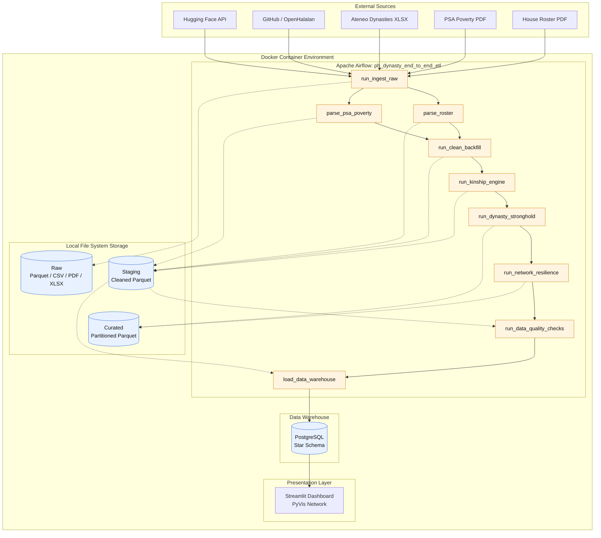
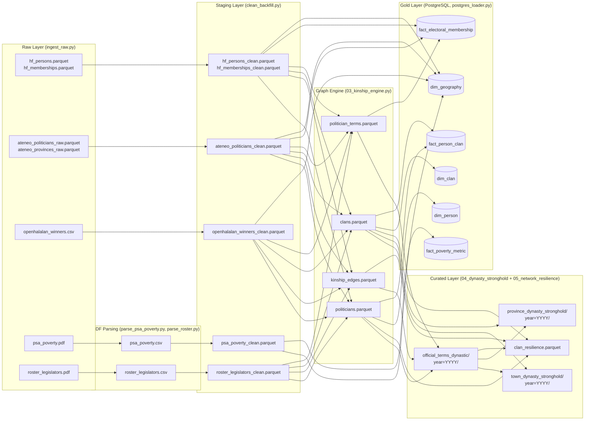

# Philippine Political Dynasty Analytics & Network Resilience Pipeline

An end-to-end, containerized Data Engineering pipeline that ingests, cleans, models, and analyzes multi-decade Philippine election records and public official datasets.

The system maps familial ties (including multi-hop kinship such as siblings, 1st cousins, and maternal links) to calculate empirical town-level dynasty stronghold metrics and run network percolation/cascade simulations to test dynasty resilience under systemic political disruptions.

## Table of Contents

- [A. Project Context and Motivation](#a-project-context-and-motivation)
- [B. Tech Stack](#b-tech-stack)
- [C. End-to-End Architecture](#c-end-to-end-architecture)
- [D. Data Sources and Provenance](#d-data-sources-and-provenance)
- [E. Data Lineage and Transformation Flow](#e-data-lineage-and-transformation-flow)
- [F. Storage Format Benchmarking and Partitioning Strategy](#f-storage-format-benchmarking-and-partitioning-strategy)
- [G. Getting Started](#g-getting-started)
- [H. Verifying Outputs and Rerun Safety](#h-verifying-outputs-and-rerun-safety)
- [I. Troubleshooting](#i-troubleshooting)
- [J. Future Improvements](#j-future-improvements)

---

## A. Project Context and Motivation

| | |
| :--- | :--- |
| **Problem Statement** | The 1987 Philippine Constitution prohibits political dynasties, yet enabling legislation has never been passed. Quantifying the entrenchment and resilience of these political clans is computationally difficult due to highly fragmented, non-relational historical electoral records dispersed across multiple decades and file formats. |
| **Objectives** | Build a reproducible Medallion Architecture pipeline to extract and standardize historical records; programmatically resolve familial networks using graph theory; and simulate targeted disqualification cascades to identify network vulnerabilities. |
| **Stakeholders** | COMELEC, political science researchers, policy-makers, and election watchdogs (e.g., PCIJ, NAMFREL). |
| **Scope** | Electoral records from 1988 to 2025 covering local (Mayor, Vice Mayor, Councilor), provincial (Governor, Vice Governor, Board Member), and district-level (House of Representatives) positions. House members are also covered from 1907 through the House roster of legislators. |
| **Limitations** | Data is left-censored (pre-1988 local data is mostly unavailable). Kinship mapping relies on naming conventions (shared surnames and maternal middle names) rather than official birth certificates. Geographic joins rely on reviewed mapping dictionaries, so place names that are spelled differently across sources (for example in the PSA poverty tables) can still fail to match. |
| **Intended Data Product** | A fully orchestrated, idempotent ETL pipeline producing curated Parquet partitions and a PostgreSQL data warehouse, surfaced via an interactive Streamlit graph-analytics dashboard. |

## B. Tech Stack

| Layer | Technology |
| :--- | :--- |
| **Orchestration** | Apache Airflow 2.9.1 |
| **Database & Modeling** | PostgreSQL 15 (Star Schema) |
| **Storage Layers** | Medallion Architecture (Raw > Staging > Curated Parquet) |
| **Graph & Simulation Engine** | NetworkX |
| **Deployment** | Docker & Docker Compose (Python 3.11) |
| **Exploratory UI** | Streamlit + PyVis |

## C. End-to-End Architecture



*Solid arrows between tasks are the Airflow dependencies. Dotted arrows show which storage layer each task writes to or reads from. Blue cylinders are storage; orange boxes are Airflow tasks. Each task runs a Python script in `src/`; the notebooks in `notebooks/` repeat the same steps for exploring and checking results and are not run by the pipeline.*

## D. Data Sources and Provenance

| Source Name | URL | Format / Type | Access Date & Freq. | License | Retrieval Method | Role in Pipeline |
| :--- | :--- | :--- | :--- | :--- | :--- | :--- |
| **BetterGov.PH Raw Data** | https://huggingface.co/datasets/bettergovph/raw-philippine-data | Parquet | Oct 2026 (Corrections only; 2004–2016 history) | CC0 1.0 | **Automated** (Hugging Face API) | **Entity Resolution Core:** Contains pre-linked `person_id` records resolving longitudinal identity across terms (2004–2016). |
| **Ateneo Policy Center Dynasties (2022)** | https://www.inclusivedemocracy.ph/data-and-infographics | Excel (`.xlsx`) | Oct 2026 (New edition after some elections; latest 2022) | May not be redistributed (used with citation; not stored in this repository) | **Manual** (Provided in `data/raw/`) | **Dynasty Ground Truth:** 207,000+ records (1987–2022) providing continuous sub-national coverage and academic fat-dynasty benchmarks. |
| **OpenHalalan Winners** | https://github.com/RobertRLeung/OpenHalalan | CSV | Oct 2026 (Per Election, every 3 years, plus corrections) | Open Database License (ODbL) v1.0 | **Automated** (Python `requests`) | **Longitudinal Extension:** Extends winners to 2001 and 2019–2025. |
| **PSA Poverty Incidence** | https://psa.gov.ph (2023 Full Year Official Poverty Statistics) | PDF | Oct 2026 (New full-year release every few years: 2018, 2021, 2023) | Public government document | **Manual** (`pdfplumber` parsing) | **Socioeconomic Covariate:** Enables exploratory correlation between provincial dynasty stronghold rates and poverty incidence. |
| **House of Reps Roster (1907-2019)** | https://hrep-website.s3.ap-southeast-1.amazonaws.com/download/docs/roster-legislators.pdf | PDF | Oct 2026 (Rarely; fixed PDF) | Public government document | **Automated** (Python `requests`, with a Wayback Machine copy as backup; `pdfplumber` parsing) | **50+ Year Historical Depth:** Reaches prior to Martial Law, enabling tracking of national legislative dynasties across regime changes. |

If an automated download fails, `run_ingest_raw` stops with an error that says which file to save in `data/raw/` by hand. Placeholder files are only written when `ALLOW_FALLBACK=1` is set in `.env` (for offline testing; off by default).

## E. Data Lineage and Transformation Flow



## F. Storage Format Benchmarking and Partitioning Strategy

The Medallion Architecture's Staging (Silver) and Curated (Gold) local directories utilize Apache Parquet exclusively over CSV or JSON. This design choice optimizes I/O throughput and enforces strict data contracts before PostgreSQL ingestion.

### Format Comparison

| Feature | CSV | JSON | Columnar Parquet |
| :--- | :--- | :--- | :--- |
| **Schema Enforcement** | None (Inferred on read) | Weak (Nested structures) | **Strict (Embedded metadata)** |
| **Storage Footprint** | Large (Uncompressed text) | Very Large (Repeated keys) | **Minimal (Snappy compression)** |
| **I/O Performance** | Slow (Row-based full scans) | Very Slow (Tree traversal) | **Extremely Fast (Columnar chunking)** |
| **Data Type Retention** | Fails on Null Ints/Booleans | Loses Datetime objects | **Preserves all pandas/SQL dtypes** |

### Measured Benchmark

Two pipeline tables were written and read back in each format with pandas and pyarrow (Python 3.11, median of five runs):

| Table | Format | Size (MB) | Write (s) | Read (s) | Types unchanged after reading |
| :--- | :--- | ---: | ---: | ---: | :--- |
| `politician_terms` (316,169 rows, 11 columns) | CSV | 34.1 | 0.96 | 0.63 | No |
| | JSON (one record per line) | 81.6 | 1.19 | 2.13 | No |
| | **Parquet (Snappy)** | **7.8** | **0.12** | **0.04** | **Yes** |
| `politicians` (112,519 rows, 24 columns) | CSV | 18.9 | 0.63 | 0.54 | No |
| | JSON (one record per line) | 59.9 | 0.83 | 1.48 | No |
| | **Parquet (Snappy)** | **6.2** | **0.14** | **0.04** | **Yes** |

Parquet files were 3 to 4 times smaller than CSV and about 10 times smaller than JSON, and were read 13 to 16 times faster than CSV. Only Parquet returned the tables unchanged: CSV and JSON turned every year column with a missing value into decimals (2016.0).

### Justification for Parquet

1. **Type Safety for the Data Contract:** CSVs routinely corrupt nullable integers and boolean flags (as measured above, a year column with gaps comes back as `2016.0` floats). Parquet embeds the schema directly in the file, ensuring zero data mutation between the Python transformation steps and the PostgreSQL `INSERT` tasks.
2. **Hardware Optimization:** Parquet's columnar compression minimizes disk reads and CPU deserialization overhead, maximizing throughput during large data backfills.

### Hive-Style Partitioning

The pipeline saves curated datasets using temporal partitioning:

```python
df.to_parquet(out, partition_cols=["year"], index=False)
```

* **Directory Structure:** This generates isolated physical folders such as `data/curated/town_dynasty_stronghold/year=2022/` and `year=2025/`. The same is done for `official_terms_dynastic/` and `province_dynasty_stronghold/` (13 election years, 1988 to 2025).
* **Partition Pruning (Predicate Pushdown):** Downstream analytical engines or dashboard queries targeting a specific election cycle only scan that specific directory chunk, entirely skipping decades of unrelated historical data. This drastically reduces memory overhead during UI rendering. Example:

```python
import pandas as pd
pd.read_parquet("data/curated/town_dynasty_stronghold", filters=[("year", "=", 2025)])
```

## G. Getting Started

### 1. Prerequisites

* Docker and Docker Compose installed and running (give Docker at least 8 GB of memory).
* This repository cloned locally:

```bash
  git clone https://github.com/SrPenguin000/ph-political-dynasty-project.git
  cd ph-political-dynasty-project
```

### 2. Configure Environment Variables

1. Copy the template: `cp .env.example .env` (Windows PowerShell: `Copy-Item .env.example .env`)
2. Open `.env` and securely set `AIRFLOW_ADMIN_USER`, `AIRFLOW_ADMIN_PASSWORD`, and your PostgreSQL credentials.

### 3. Stage Manual Files

Place the manually retrieved PDF and Excel files in the `data/raw/` directory prior to execution (create the folder if it does not exist). The Hugging Face, OpenHalalan, and House roster files are downloaded automatically.

| File | Source |
| :--- | :--- |
| `psa_poverty.pdf` | PSA Poverty Incidence |
| `Ateneo_Policy_Center_Philippine_Political_Dynasties_Dataset__2022_Update_.xlsx` (any `.xlsx` with "Ateneo" in its name works) | Ateneo Policy Center Dynasties Dataset |

### 4. Start the Environment

Spin up the containerized Medallion environment using Docker Compose:

```bash
docker compose up --build -d
```

> [!IMPORTANT]
> The `--build` flag is strictly required on the first run to ensure `networkx` and `scipy` dependencies are properly baked into the Airflow worker image.

Check the containers with `docker compose ps`. `dynasty_postgres`, `dynasty_airflow_webserver`, `dynasty_airflow_scheduler`, and `dynasty_dashboard` should be running; `dynasty_airflow_init` sets up Airflow and then exits, which is expected.

### 5. Trigger the Pipeline

1. Navigate to the Airflow UI at http://localhost:8080 and log in using the credentials defined in your `.env` file.
2. Locate the primary DAG named `ph_dynasty_end_to_end_etl`.
3. Unpause the DAG by clicking the toggle switch on the far left (it will turn blue).
4. Click the "Play" (▶) button in the top right and select **Trigger DAG**.
5. Click on the DAG name and navigate to the **Graph** tab to monitor task execution in real-time. All nine tasks should turn dark green.

To stop the environment, run `docker compose down` (add `-v` to also delete the database for a full reset).

### Pipeline Cadence

The sources change on an "Ad-hoc/Per Election" basis due to the 3-year Philippine election cycle, so the DAG runs in two ways:

* **Scheduled:** the Airflow DAG `schedule_interval` is set to `@monthly` (first day of each month, no catch-up). This ensures the pipeline regularly polls the Hugging Face and GitHub sources to capture asynchronous dataset corrections, late COMELEC rulings, or midterm special election results.
* **On demand:** trigger the DAG by hand after a new election is published, or after a new Ateneo or PSA file is saved in `data/raw/`.

Because every run rebuilds its outputs, a run with no source changes produces the same results.

## H. Verifying Outputs and Rerun Safety

The pipeline is fully idempotent. Rerunning the DAG will safely overwrite local files and execute `UPSERT` logic (`INSERT ... ON CONFLICT`) in PostgreSQL to prevent data duplication.

### 1. Data Warehouse (PostgreSQL)

Access the database container to verify the final Gold layer tables:

```bash
docker exec -it dynasty_postgres psql -U <your_postgres_user> -d <your_postgres_db>
```

Run validation queries to confirm idempotency and accurate loading (run them, trigger the DAG again, and check that the counts did not change):

```sql
SELECT COUNT(*) FROM fact_electoral_membership;
SELECT COUNT(*) FROM dim_person;
SELECT COUNT(*) FROM dim_clan;
SELECT * FROM dim_person LIMIT 5;
```

### 2. Curated File Partitions (Local Storage)

Verify that the Medallion architecture successfully partitioned the final Parquet datasets by year for optimized downstream querying. Check the local project directories:

* `data/curated/official_terms_dynastic/year=2025/`
* `data/curated/town_dynasty_stronghold/year=2025/`
* `data/curated/province_dynasty_stronghold/year=2025/`
* `data/curated/clan_resilience.parquet`

Expected sizes from the October 2026 run: 112,519 people, 316,169 term records, 263,565 kinship links, and 20,288 clans.

### 3. Interactive Analytics Dashboard

Access the Streamlit dashboard at http://localhost:8501 to explore the output, featuring network resilience simulations and geographic stronghold phase-transition maps.

## I. Troubleshooting

| Symptom | Cause | Fix |
| :--- | :--- | :--- |
| **Container port conflicts** | `localhost:5432` or `8080` is already in use by a local PostgreSQL or Airflow installation. | Modify the left-side port bindings in `docker-compose.yml` (example: `"5433:5432"`). |
| **Silent failures / empty dashboard** | The DAG succeeded but the Streamlit dashboard did not populate. | Check the `run_data_quality_checks` task logs in Airflow. The pipeline is designed to intentionally halt database ingestion if strict primary key or null constraint validations fail. |
| **`run_ingest_raw` fails: Ateneo dataset not found** | The Ateneo Excel file is not in `data/raw/`. | Save the file as shown in Step 3 of [Getting Started](#g-getting-started), then clear the task in Airflow to rerun it. |
| **`run_ingest_raw` fails: roster or PSA download failed** | The website could not be reached. | Download the file in a browser and save it as `data/raw/roster_legislators.pdf` or `data/raw/psa_poverty.pdf`; the next run uses the saved file. |
| **`ModuleNotFoundError: No module named 'src'`** | A script was run by hand from the wrong folder. | Run scripts from the project folder, e.g. `python src/curate/03_kinship_engine.py`. |
| **`run_network_resilience` fails with a `TypeError`** | Scripts were run by hand out of order. | Run `03_kinship_engine.py`, then `04_dynasty_stronghold.py`, then `05_network_resilience.py` (Airflow always runs them in this order). |

## J. Future Improvements

* **Advanced Entity Resolution:** Implement fuzzy string matching (e.g., Levenshtein distance) to resolve persistent geographic `LEFT JOIN` anomalies between electoral datasets and the PSA poverty metrics.
* **Graph Database Migration:** Transition the final curated Gold layer from PostgreSQL to a native graph database (Neo4j) to accelerate multi-hop kinship cascade queries.
* **Explicit Kinship Enrichment:** Query the Wikidata SPARQL API for documented family relations (spouse, parent, sibling) to verify the inferred surname links. This is not part of the pipeline yet.

